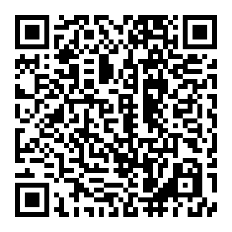

# Minigame Tư tưởng Hồ Chí Minh

## Phòng chống tin giả

Kiểm chứng 30 bản tin theo bộ câu hỏi trắc nghiệm Bài 4 (Chương 3), chia năm vòng: đúng/sai,
chọn một phương án đúng, chọn phương án sai, chọn nhiều phương án đúng, điền khuyết. Mỗi câu
công bố đáp án và giải thích ngay; cuối game có bảng kết quả và danh sách câu cần xem lại.

- **Vào chơi:** https://haianhhadang-collab.github.io/minigame-tthcm/phong-chong-tin-gia/
- Bản cũ (66 câu nguyên văn, chơi cả lớp): https://haianhhadang-collab.github.io/minigame-tthcm/phong-chong-tin-gia/ban-66-cau/

## Ai chưa chính xác?

Đúng một thẻ bị tráo cụm then chốt, cả nhóm đọc to rồi bỏ phiếu. Chơi một mình, mỗi người một máy
(mã ván), hoặc một máy chuyền tay.

- **Vào chơi:** https://haianhhadang-collab.github.io/minigame-tthcm/ai-chua-chinh-xac/

## Hải trình Gió Mùa (Monsoon Voyage) — Islam ở Đông Nam Á

40 câu về bài giảng *Islam in Southeast Asia* qua tám thương cảng, năm dạng câu (mỗi dạng 8 câu): đọc hiểu,
phân tích cấu trúc, tóm lược đoạn, trắc nghiệm, điền vào chỗ trống. Giao diện và lời bình của Gió Mùa bằng tiếng Anh.
Ba chế độ: chơi cá nhân (3 mức, mạng, vật phẩm, bảng vàng); thi đội trên một máy chiếu (cướp câu, Gió thuận, Bão biển);
và **Live stream**: giảng viên mở phòng trên máy chiếu, sinh viên quét QR trả lời bằng điện thoại, máy chiếu tường thuật
trực tiếp (đọc thành tiếng được), có bảng xếp hạng và tải kết quả CSV. Mỗi câu có lời giải trích nguyên văn bài giảng.
Hết hải trình, giảng viên có thể mở **vòng thưởng Listening Challenge**: ba người dẫn đầu chọn thi hoặc không; ai thi thì
nghe bài hội thoại 5 phút (`islam-dong-nam-a/nghe/`) bằng tai nghe trên điện thoại và làm 10 câu rút ngẫu nhiên riêng cho
từng người (3 dễ, 2 vừa, 3 khó, 2 nâng cao, từ ngân hàng 24 câu). Mỗi câu đúng cộng 3% điểm hải trình, tối đa +30%.

- **Vào chơi:** https://haianhhadang-collab.github.io/minigame-tthcm/islam-dong-nam-a/
- Poster in A3: [PNG](islam-dong-nam-a/poster.png) · [PDF](islam-dong-nam-a/poster.pdf)
- Chế độ Live stream nối máy chiếu với điện thoại qua broker MQTT công cộng (EMQX, dự phòng HiveMQ), không cần
  tài khoản hay máy chủ riêng. Tin nhắn chỉ có tên sinh viên tự đặt và lựa chọn; mọi máy cần có mạng.

---

## Voyage of the Bell — Kitô giáo ở Đông Nam Á

60 câu về bài giảng *Christianity in Southeast Asia: Historiography, Encounters, and Vernacular Transformations* qua
mười hai cảng (Manila, Barus, Malacca, Cebu, Đàng Trong, Rangoon, Penang, Lake Toba, Dumaguete, Dili, Highlands,
Yogyakarta), năm dạng câu (mỗi dạng 12 câu). Người dẫn chuyện là Chiếc Chuông (*bajo de la campana*); giao diện tiếng Anh.
Cùng khung với Hải trình Gió Mùa: chơi cá nhân, thi đội, Live stream qua máy chiếu. Vòng thưởng **Listening Challenge**
dùng bài nghe 5 phút ở phòng trưng bày lịch sử (`kito-giao-dong-nam-a/nghe/`), ngân hàng 24 câu, mỗi người 10 câu ngẫu
nhiên; mỗi câu đúng cộng 3% điểm hải trình, tối đa +30%.

- **Vào chơi:** https://haianhhadang-collab.github.io/minigame-tthcm/kito-giao-dong-nam-a/

---

Câu hỏi và trích dẫn của hai game Tư tưởng Hồ Chí Minh lấy từ **Giáo trình Tư tưởng Hồ Chí Minh 2026**; game Hải trình Gió Mùa lấy từ bài giảng *Islam in Southeast Asia*; Voyage of the Bell lấy từ bài giảng *Christianity in Southeast Asia*.
Kho này chỉ chứa học liệu phát cho sinh viên — không có đề thi, bản giáo trình hay danh sách lớp.
