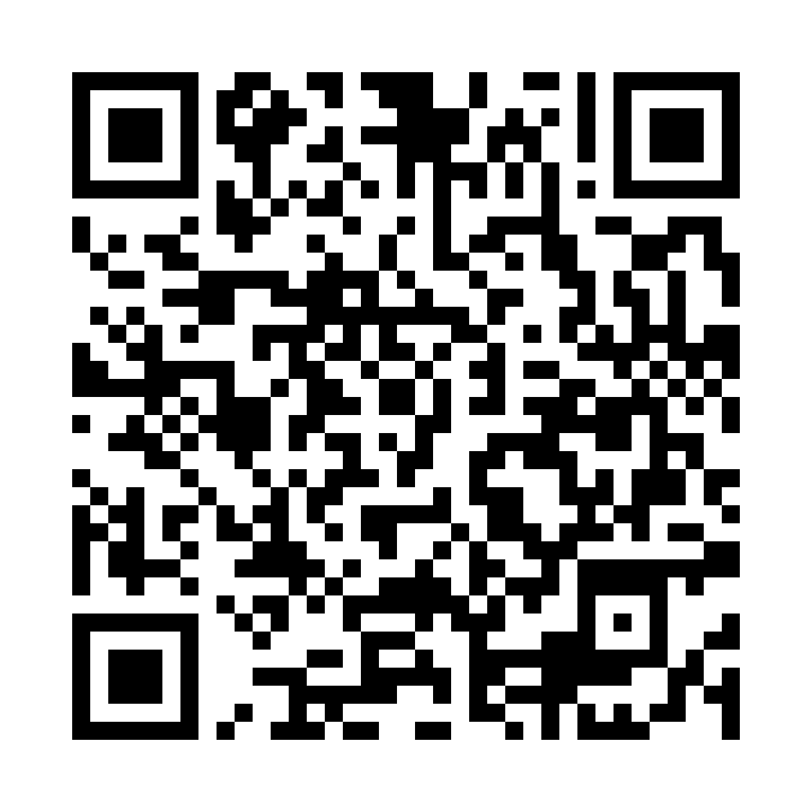
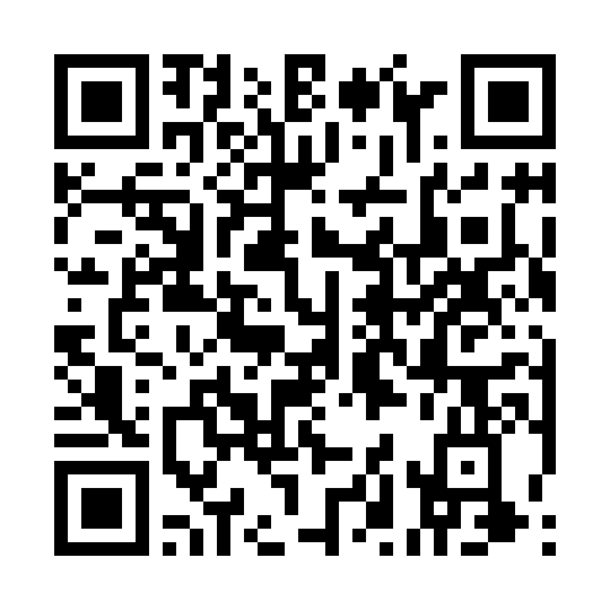

# Minigame Tư tưởng Hồ Chí Minh

## Phòng chống tin giả

Tìm nguyên văn giữa các cụm “tin giả” do nhân vật Kẻ Khoác Lác tung ra. Chơi một mình, hoặc cả lớp
qua máy chiếu — các nhóm tự bịa để lừa nhau (+2 chọn đúng, +1 mỗi nhóm bị lừa).

- **Vào chơi:** https://haianhhadang-collab.github.io/minigame-tthcm/phong-chong-tin-gia/

## Ai chưa chính xác?

Đúng một thẻ bị tráo cụm then chốt, cả nhóm đọc to rồi bỏ phiếu. Chơi một mình, mỗi người một máy
(mã ván), hoặc một máy chuyền tay.

- **Vào chơi:** https://haianhhadang-collab.github.io/minigame-tthcm/ai-chua-chinh-xac/

---

Câu hỏi và trích dẫn lấy từ **Giáo trình Tư tưởng Hồ Chí Minh 2026**.
Kho này chỉ chứa học liệu phát cho sinh viên — không có đề thi, bản giáo trình hay danh sách lớp.
